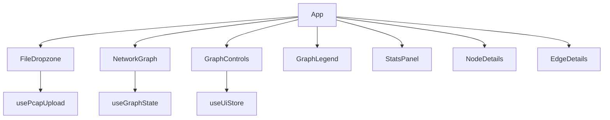

> ⚠️ ARCHIVED — written pre-backend-switch; it describes a Spring Boot backend
> that never shipped. Historical only — do NOT use as ground truth.
> Ground truth: `.opencode/knowledge/stack/tech-stack.md`

# Architecture

This document describes how the NetVisor frontend is structured and how data flows through the application.

---

## High-Level Overview

NetVisor is a single-page application that:

1. Accepts a PCAP file upload via drag-and-drop
2. Sends it to the Spring Boot backend for parsing
3. Receives a topology response (nodes, edges, statistics)
4. Renders an interactive network graph using Cytoscape.js

---

## Data Flow

```mermaid
graph LR
    A[User drops PCAP file] --> B[FileDropzone]
    B --> C[usePcapUpload hook]
    C --> D["POST /api/pcap/upload"]
    D --> E[Spring Boot Backend]
    E --> F[TopologyResponse]
    F --> G[TanStack Query Cache]
    G --> H[useGraphState hook]
    H --> I[Zustand Filters]
    I --> J[Filtered Elements]
    J --> K[NetworkGraph + Cytoscape]
```



### Step by step

1. **Upload** — `FileDropzone` uses `react-dropzone` to accept `.pcap` / `.pcapng` files (max 200 MB)
2. **Mutation** — `usePcapUpload` wraps the API call in a TanStack Query `useMutation`
3. **API** — `uploadPcapFile()` sends a `POST` with `FormData` to the backend
4. **Cache** — on success, the response is cached under `["topology", sessionId]`
5. **Filtering** — `useGraphState` reads filters from Zustand and applies them via `useMemo`
6. **Rendering** — filtered elements are passed to `NetworkGraph` (Cytoscape.js)

---

## State Management

The app uses two state management approaches:

### Server State — TanStack Query

Handles all backend communication. The upload response is cached by `sessionId`:

```typescript
queryClient.setQueryData(["topology", data.sessionId], data);
```

This allows components to access the topology data via `useQuery` without re-fetching.

### UI State — Zustand

The `useUiStore` manages lightweight UI concerns:

| State | Type | Purpose |
|---|---|---|
| `selectedNodeId` | `string \| null` | Currently selected graph node |
| `selectedEdgeId` | `string \| null` | Currently selected graph edge |
| `graphLayout` | `cose \| dagre \| circle \| grid` | Active Cytoscape layout algorithm |
| `filters.protocols` | `string[]` | Protocol whitelist filter |
| `filters.minPackets` | `number` | Minimum packet threshold |

Selecting a node clears the edge selection and vice versa.

---

## Component Hierarchy



### Current state

| Component | Status | Location |
|---|---|---|
| `App` | Implemented | `src/App.tsx` |
| `FileDropzone` | Implemented | `src/components/upload/FileDropzone.tsx` |
| `NetworkGraph` | Placeholder | `src/components/graph/NetworkGraph.tsx` |
| `GraphControls` | Stub | `src/components/graph/GraphControls.tsx` |
| `GraphLegend` | Stub | `src/components/graph/GraphLegend.tsx` |
| `StatsPanel` | Partial | `src/components/stats/StatsPanel.tsx` |
| `NodeDetails` | Stub | `src/components/details/NodeDetails.tsx` |
| `EdgeDetails` | Stub | `src/components/details/EdgeDetails.tsx` |

---

## Type System

### `network.types.ts` — Domain types

Defines the application's domain model:

- `NodeType` — union: `router | server | client | unknown`
- `NetworkNode` — host with id, label, type, packet/byte counts, protocols
- `NetworkEdge` — connection between two hosts with weight and traffic stats
- `SessionStats` — aggregate stats (total packets, bytes, hosts, protocols, duration)
- `TopologyResponse` — full API response wrapping `sessionId`, `elements`, and `stats`

### `cytoscape.types.ts` — Graph types

Generic Cytoscape-compatible types used for graph rendering. These largely mirror the domain types but use `Record<string, unknown>` for flexibility.

---

## API Integration

### Endpoint

```
POST /api/pcap/upload
Content-Type: multipart/form-data
Body: file (PCAP/PCAPNG binary)
```

### Response shape

```typescript
interface TopologyResponse {
  sessionId: string;
  elements: {
    nodes: Array<{ data: NetworkNode }>;
    edges: Array<{ data: NetworkEdge }>;
  };
  stats: SessionStats;
}
```

### Vite proxy (development)

In development, Vite proxies `/api` requests to `http://localhost:8080` so the frontend and backend can run on different ports without CORS issues.

---

## Folder Structure

| Directory | Purpose |
|---|---|
| `src/api/` | Fetch functions and request/response types |
| `src/components/upload/` | File upload UI (drag-and-drop) |
| `src/components/graph/` | Cytoscape graph visualization |
| `src/components/details/` | Selected node/edge detail panels |
| `src/components/stats/` | Session statistics display |
| `src/hooks/` | Custom React hooks (mutations, derived state) |
| `src/stores/` | Zustand stores (UI state) |
| `src/types/` | TypeScript interfaces and type aliases |
| `src/lib/` | Utility functions |
| `docs/` | Project documentation |
